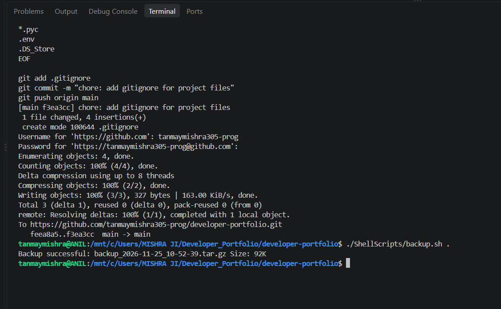
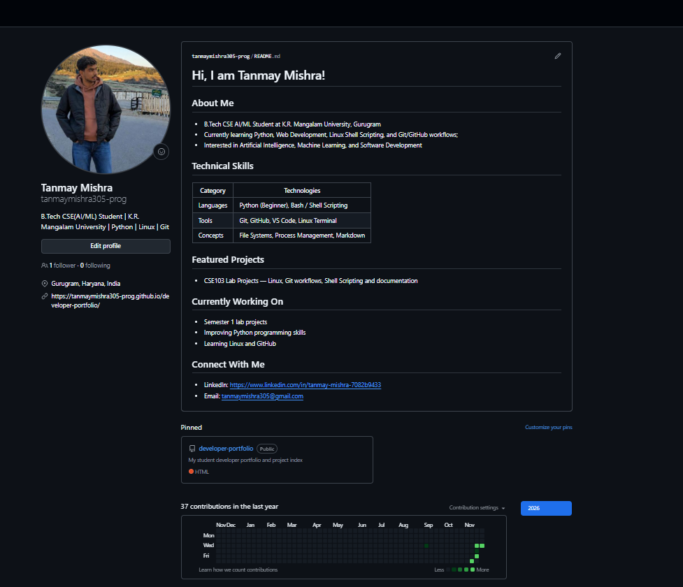
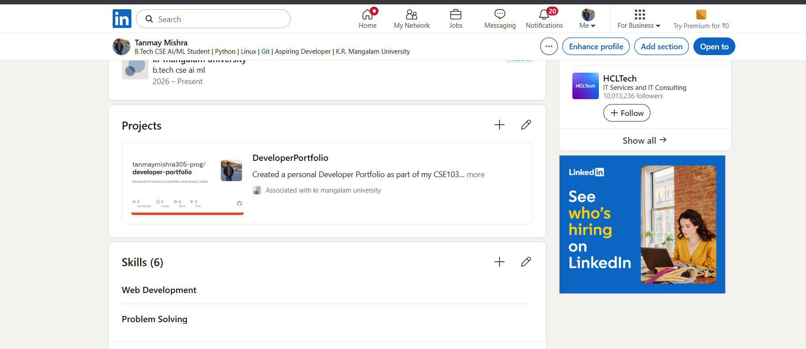
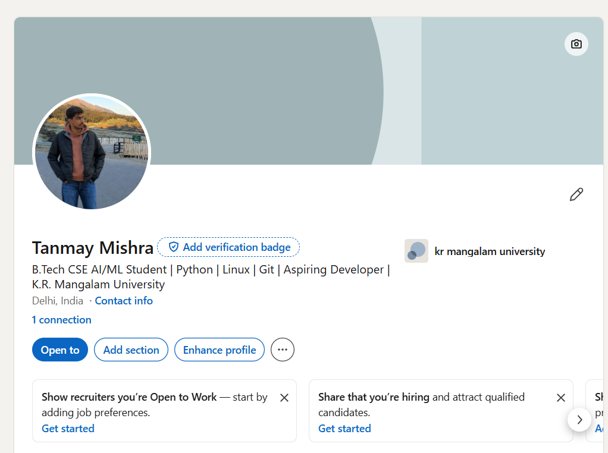
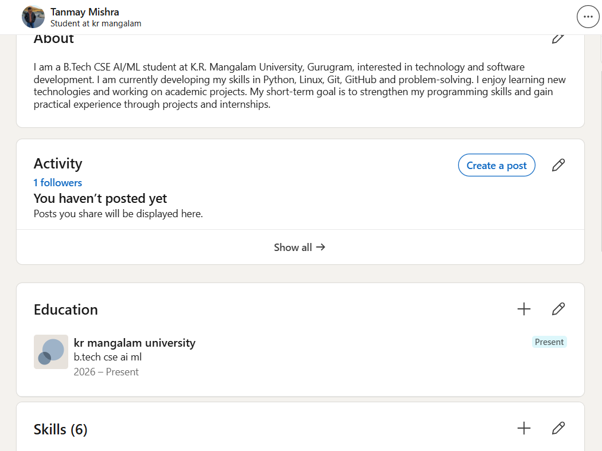
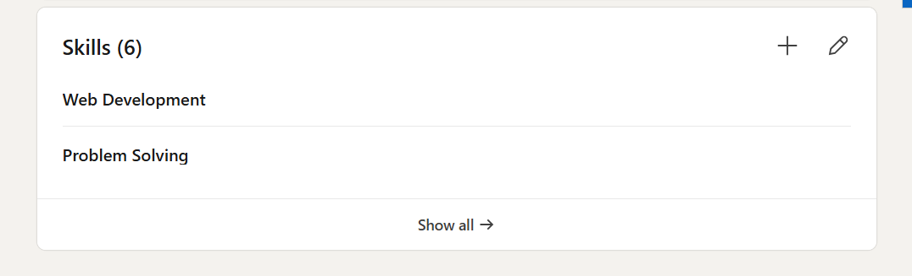
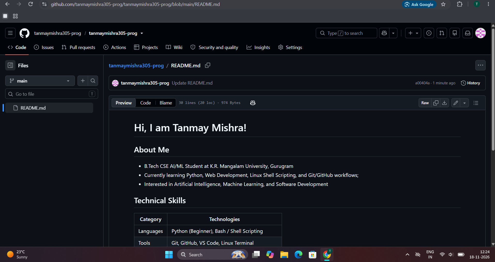
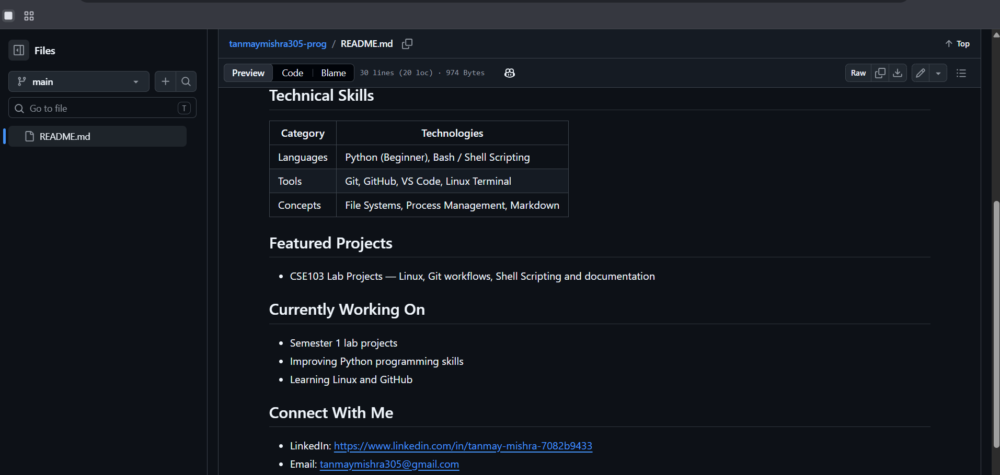

# Tanmay Mishra — Developer Portfolio

> B.Tech CSE AI/ML Student | K.R. Mangalam University, Gurugram

---

## Repository Index

| Repository | Description | Tech Stack | Status |
|---|---|---|---|
| [cse103-lab-LAB3](https://github.com/tanmaymishra305-prog/cse103-lab-LAB3) | CSE103 lab — Git, APIs, Shell scripting | Git, Python, Bash | Active |
| [developer-portfolio](https://github.com/tanmaymishra305-prog/developer-portfolio) | This portfolio index | Markdown | Active |

---

## Current Skills

- Python — Beginner
- Linux / Bash — Beginner
- Git / GitHub — Beginner

---

## Learning Roadmap

Learning Python, Linux, Git/GitHub, and AI/ML fundamentals.

## Progress Tracker

Working on Semester 1 lab projects and improving programming skills.

## Screenshots

### Backup Script Demo

### GitHub Profile

### LinkedIn Profile

### LinkedIn Screenshots

### GitHub Profile README

